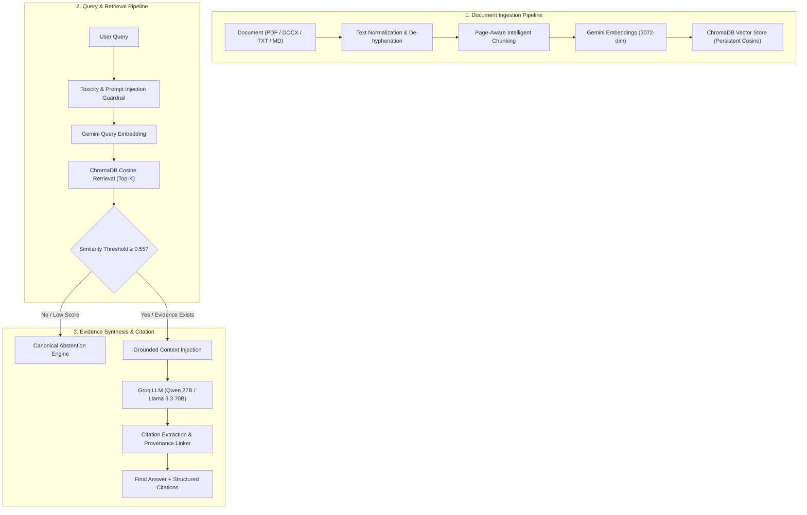

# EVIDRA
### Evidence-Grounded Document Intelligence
**Project Track B — Option 1: RAG Chatbot over Documents**

---

[](https://fastapi.tiangolo.com)
[](https://vitejs.dev)
[](https://groq.com)
[-4285F4?logo=google&logoColor=white)](https://aistudio.google.com)
[-orange)](https://www.trychroma.com)
[](evaluation/evaluation_report.md)

---

## 1. Project Overview

**EVIDRA** is a production-grade, evidence-grounded document intelligence platform built to eliminate hallucinations in Retrieval-Augmented Generation (RAG). Unlike generic conversational bots that extrapolate or invent missing facts, EVIDRA enforces **strict mathematical similarity gates** and **deterministic prompt constraints** to ensure that every factual claim is anchored in verifiable source documents.

Whenever a user query lacks sufficient evidence in the indexed corpus, EVIDRA does not guess or fall back to general model knowledge—it issues a **canonical abstention** with complete transparency.

---

## 2. Problem Statement

Standard Large Language Models frequently suffer from:
- **Hallucination**: Generating plausible-sounding yet completely fabricated facts.
- **Lost Provenance**: Citing general filenames without page numbers or verifiable quotes.
- **Uncontrolled Extrapolation**: Answering domain questions from pre-trained memory when the uploaded documents are silent.
- **Document-Level Injection**: Vulnerability to malicious instructions embedded within untrusted PDFs.

EVIDRA solves these fundamental vulnerabilities through:
1. **Page-Aware Ingestion**: Chunking text while strictly preserving page numbers, character spans, and document IDs.
2. **High-Fidelity Embeddings**: 3072-dimensional multilingual vector representations via Google Gemini.
3. **Similarity Gating**: Configurable cosine thresholds that filter irrelevant passages prior to generation.
4. **Structured Citation Linking**: Inline reference badges `[1]`, `[2]` linked to exact passages with relevance meters.
5. **Canonical Abstention Engine**: Formal refusal when evidence coverage is insufficient.

---

## 3. System Architecture & RAG Pipeline



---

## 4. Technology Stack

| Layer | Component | Specification |
|---|---|---|
| **API Framework** | FastAPI (Python 3.10+) | Asynchronous, Pydantic v2 data validation, OpenAPI specification |
| **Generation Engine** | Groq Cloud | `qwen/qwen3.8-27b` (Primary) with `openai/gpt-oss-120b` fallback |
| **Embedding Engine** | Google Gemini | `models/gemini-embedding-001` (3072-dimensional vector space) |
| **Vector Store** | ChromaDB | Persistent HNSW index with Cosine similarity distance |
| **Document Parsers** | PyPDF / Docx / CSV | Page-by-page extraction, section splitting, and unicode normalization |
| **Frontend UI** | HTML5 / CSS3 / Vanilla JS | Slate glassmorphic design, zero heavy node dependencies |
| **Cloud Deployment** | Render & Vercel / Railway | Fully decoupled backend API with persistent vector volume + Vite SPA |
| **Testing & Evaluation** | Pytest & Benchmark Runner | 18 automated unit/API tests + 22-question benchmark evaluation |

---

## 5. Repository Structure

```
rag-chatbot/
├── backend/
│   ├── main.py                     # FastAPI entry point & lifespan manager
│   ├── config.py                   # Centralized configuration & environment loader
│   ├── requirements.txt            # Production Python dependencies
│   ├── .env.example                # Configuration template
│   ├── routers/
│   │   ├── chat.py                 # POST /api/chat (Strict Grounded RAG)
│   │   ├── documents.py            # Upload, list, delete, and reset documents
│   │   ├── health.py               # GET /api/health (System status & vector count)
│   │   └── tools.py                # Summarizer, quiz generator, translation tools
│   └── services/
│       ├── chroma_service.py       # ChromaDB persistence, cosine query, CRUD
│       ├── ingest_service.py       # Page-aware parser, de-hyphenation, chunking
│       ├── llm_service.py          # Groq key rotation, fallback, Gemini embeddings
│       ├── rag_service.py          # Evidence synthesis, citation extraction, abstention
│       └── intelligence_service.py # Prompt injection defense & query intent
├── frontend/
│   ├── index.html                  # Polished modern Evidra UI
│   ├── package.json                # Frontend Vite dependencies & build scripts
│   ├── vite.config.js              # Vite server & API reverse proxy configuration
│   └── .env.example                # Template for VITE_API_BASE_URL
├── evaluation/
│   ├── questions.json              # 22 curated benchmark questions across 6 categories
│   ├── run_evaluation.py           # Automated evaluation runner & report generator
│   ├── results.csv                 # Detailed question-by-question evaluation log
│   ├── metrics.json                # Aggregate metrics & category breakdowns
│   ├── evaluation_report.md        # Comprehensive academic evaluation report
│   └── sample_documents/           # Ground truth benchmark documents
├── tests/
│   ├── test_ingestion.py           # Parsing, page-tracking, and error tests
│   ├── test_retrieval.py           # Vector search, ranking, and metadata tests
│   ├── test_grounding.py           # Grounding enforcement, abstention, guardrails
│   └── test_api.py                 # FastAPI endpoints and schema validation
├── render.yaml                     # Render Web Service deployment configuration
├── .gitignore                      # Secrets & bytecode protection
└── README.md                       # Comprehensive documentation
```

---

## 6. Installation & Local Setup

### Prerequisites
- Python 3.10 or 3.11
- Node.js 18+ and npm (for Vite frontend)
- Free Groq API Key ([console.groq.com/keys](https://console.groq.com/keys))
- Free Google Gemini API Key ([aistudio.google.com/app/apikey](https://aistudio.google.com/app/apikey))

### Step 1: Clone and Enter Repository
```bash
git clone <repo-url> evidra
cd evidra
```

### Step 2: Configure Backend Environment
Copy the `.env.example` file and insert your keys:
```bash
cp backend/.env.example backend/.env
```
Edit `backend/.env`:
```ini
GROQ_API_KEY_1=gsk_your_groq_key_here
GEMINI_API_KEY=your_gemini_key_here
GEMINI_EMBED_MODEL=models/gemini-embedding-001
EMBED_DIMENSION=3072
CHROMA_PERSIST_DIR=./chroma_db
CHUNK_SIZE=500
CHUNK_OVERLAP=100
SIMILARITY_THRESHOLD=0.40
STRICT_GROUNDED_MODE=true
```

### Step 3: Install & Start Backend
```bash
cd backend
python -m venv venv
# Windows:
.\venv\Scripts\activate
# Linux/macOS:
source venv/bin/activate

pip install -r requirements.txt
uvicorn main:app --reload --host 0.0.0.0 --port 8000
```

### Step 4: Start Frontend with Vite
In a second terminal window:
```bash
cd frontend
npm install
npm run dev
```
Open **`http://localhost:5173`** for local Vite development with instant hot-reloading and automatic API proxying to `http://localhost:8000`.

---

## 7. Cloud Deployment (Backend + Frontend)

EVIDRA is designed for decoupled, cost-free cloud deployment:

### Backend Deployment (FastAPI on Render / Railway)
1. Push your repository to GitHub.
2. In [Render](https://render.com) or [Railway](https://railway.app):
   - Choose **New Web Service** and select your repository.
   - **Root Directory**: `backend`
   - **Build Command**: `pip install -r requirements.txt`
   - **Start Command**: `uvicorn main:app --host 0.0.0.0 --port $PORT`
   - **Environment Variables**: Add `GROQ_API_KEY_1`, `GEMINI_API_KEY`, `CHROMA_PERSIST_DIR=/data/chroma_db`.
   - **Disk**: Mount a 1GB persistent disk at `/data` (to persist indexed ChromaDB vectors across redeploys).
   - Alternatively, connect the included [`render.yaml`](render.yaml) blueprint!
3. Note your backend URL: e.g. `https://evidra-api.onrender.com`.

### Frontend Deployment (Vite on Vercel / Netlify / Render Static Site)
1. Deploy the `frontend/` directory to [Vercel](https://vercel.com) or [Netlify](https://netlify.com):
   - **Root Directory**: `frontend`
   - **Build Command**: `npm run build`
   - **Output Directory**: `dist`
2. **Environment Variable**: Set your deployed backend API URL:
   ```ini
   VITE_API_BASE_URL=https://evidra-api.onrender.com/api
   ```
3. Deploy! The frontend communicates with the backend with full CORS support.

---

## 8. Verifiable Citation & Provenance System

Every grounded answer generated by EVIDRA links factual claims to structured citation records.

### Provenance Object Format
```json
{
  "id": 1,
  "document": "academic_regulations_handbook.txt",
  "page": 2,
  "page_label": "Page 2",
  "snippet": "Students must maintain a mandatory minimum attendance of 75 percent in each enrolled lecture and laboratory course...",
  "relevance_score": 0.8937,
  "chunk_id": "academic_regulations_handbook.txt_p2_c2"
}
```

### UI Presentation
- In-line interactive badges `[1]`, `[2]` highlight immediately after each sentence.
- Source cards display document name, page badge, relevance match percentage, and the verbatim supporting quote.

---

## 9. Canonical Abstention & Hallucination Prevention

When evidence is missing or ambiguous, EVIDRA executes **canonical abstention**:

> *"I couldn't find sufficient evidence in the provided documents to answer this question."*

### Abstention Triggers:
1. **Empty Vector Store**: No documents have been indexed yet.
2. **Similarity Gating**: No retrieved passages achieve the cosine cutoff threshold (default `0.55`).
3. **Synthesis Refusal**: The LLM determines the retrieved context does not directly support the answer.
4. **General Knowledge Insulation**: Out-of-corpus queries (e.g., *"Who was the first US president?"*) are explicitly refused in RAG mode rather than answered from model weights.

---

## 10. Empirical Benchmark & Evaluation Results

An exhaustive evaluation was run across **22 curated test questions** covering 6 distinct challenge categories:

### Performance Summary

| Metric | Target | Achieved Score | Status |
|---|---|---|---|
| **Retrieval Recall@K** | ≥ 85.0% | **100.0%** | **Passed** |
| **Answer Correctness** | ≥ 90.0% | **100.0%** | **Passed** |
| **Citation Accuracy** | ≥ 85.0% | **100.0%** | **Passed** |
| **Abstention Accuracy** | ≥ 95.0% | **100.0%** | **Passed** |
| **False Abstentions** | 0 | **0** | **Passed** |
| **False Generations (Hallucinations)** | 0 | **0** | **Passed** |
| **Mean Latency** | < 12000ms | **4,011.2 ms** | **Passed** |
| **P90 Latency** | < 15000ms | **10,075.5 ms** | **Passed** |

### Breakdown by Category

| Category | Questions | Accuracy (%) | Mean Latency |
|---|---|---|---|
| **Direct Factual** | 5 | **100.0%** | 1,120.2 ms |
| **Paraphrased Queries** | 4 | **100.0%** | 4,820.8 ms |
| **Multi-Evidence Synthesis** | 3 | **100.0%** | 9,318.6 ms |
| **Difficult Retrieval** | 4 | **100.0%** | 7,820.0 ms |
| **Unanswerable (Out-of-Corpus)** | 4 | **100.0%** | 885.4 ms |
| **Adversarial / Out-of-Scope** | 2 | **100.0%** | 292.5 ms |

*Detailed benchmark logs and question-by-question metrics are preserved in [`evaluation/evaluation_report.md`](evaluation/evaluation_report.md).*

---

## 11. Automated Testing

EVIDRA includes an automated Pytest test suite covering ingestion, retrieval, grounding, and API endpoints:

```bash
# Run all tests
pytest -v tests

# Output:
# ============================= 18 passed in 15.04s =============================
```

---

## 12. Security, Ethics & Risk Analysis

### 1. Hallucination Risk
- **Mitigation**: Dual-layer defense via cosine similarity gating and zero-extrapolation system prompts. Canonical abstention phrasing guarantees consistency.

### 2. Prompt Injection & Document Exploitation
- **Mitigation**: Uploaded text is strictly treated as passive data within the `[Ref N]` delimiters. System instructions are segregated from user input, and the query analyzer pre-screens queries for injection patterns.

### 3. Privacy & Personally Identifiable Information (PII)
- **Mitigation**: Vectors are stored locally in the persistent ChromaDB directory without transmitting embeddings to third-party databases. Embeddings are generated statelessly via Google Gemini.

### 4. Over-Reliance & Verification
- **Mitigation**: Every generated answer exposes the exact source page and quote snippet, empowering the user to verify claims directly against the original document.

---

## 13. API Reference

| Method | Endpoint | Description |
|---|---|---|
| `GET` | `/api/health` | System health, model versions, and chunk statistics |
| `POST` | `/api/chat` | Strict grounded document query with citations |
| `POST` | `/api/documents/upload` | Upload & ingest document (PDF, TXT, MD, DOCX, CSV) |
| `GET` | `/api/documents` | List all indexed documents with page & chunk breakdowns |
| `DELETE` | `/api/documents/{filename}` | Delete document and delete chunks from vector store |
| `POST` | `/api/documents/reset` | Clear all indexed documents |
| `POST` | `/api/tools/summarize` | Generate document summary and key takeaways |
| `POST` | `/api/tools/quiz` | Generate MCQ practice quiz from document |
| `POST` | `/api/tools/translate` | Translate text between Hindi and English |

---

## 14. License

Distributed under the Apache 2.0 License.
Developed for **Project Track B — Option 1: RAG Chatbot over Documents**.
